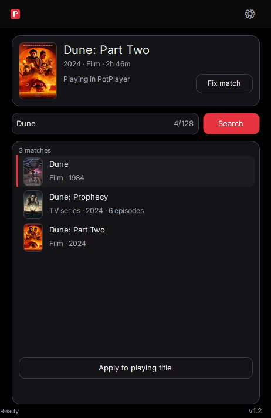

<p align="center">
  
</p>

<h1 align="center">Potflix</h1>

<p align="center"><strong>Show what PotPlayer is playing on your Discord profile, with matched artwork and episode details.</strong></p>

<p align="center">
  
</p>

<p align="center">
  
  <a href="LICENSE"></a>
</p>

## Why Potflix

PotPlayer has no built-in way to show what it is playing on Discord. Potflix reads the playing title, matches it against a provider and publishes a Rich Presence card with the artwork and details.

- **Matched cards.** Poster, year, runtime or episode line appear when a provider finds the title.
- **One fix for a bad match.** Fix match searches again and applies the chosen result to the playing title.
- **Out of the way.** Closing the window parks the app in the tray; the gear opens Settings.
- **Your own app id.** Point it at your Discord application when you want your own name and artwork.

## Install

Download `Potflix-Setup-*.exe` from the [latest release](https://github.com/nathwn12/potflix/releases/latest) and run it. It installs for the current user with no admin prompt.

`potflix.exe` is the portable build: run it from any folder.

## Use it

Start PotPlayer and play something. Potflix shows `Watching <title>` on your Discord profile, with the poster, year, runtime, or episode line when a provider matches the title.

- **Fix match** opens the search when the automatic match is wrong; pick a result and apply it to the playing title.
- Closing the window parks the app in the tray; right-click the tray icon to open or exit.
- The gear icon in the title bar opens Settings.

## Configure it

| Setting | Default | Notes |
| --- | --- | --- |
| Discord connection | On | Session toggle; back on at the next launch |
| Close to tray | On | Session toggle; back on at the next launch |
| Run at startup | Off | Adds a per-user startup entry |
| Theme | AMOLED | AMOLED or Dark |
| Scan speed | Turbo | Turbo, Balanced, or Gentle provider rate |
| Library folders | None | Watched media folders |
| Card lines | Per kind | Details and State presets for series and movies |

Use your own Discord application id for your own app name and artwork:

```powershell
# the env var wins over client-id.txt and config.properties
$env:POTFLIX_CLIENT_ID = "123456789012345678"
.\potflix.exe
```

To keep the id, put it in `client-id.txt` beside `potflix.exe`. Resolution order is the env var, then the files beside the exe, then the files in the current directory, with `client-id.txt` before `config.properties` in each.

## Requirements

- Windows, 64-bit
- PotPlayer running with media playing
- The Discord desktop app running and signed in
- To build: a stable Rust toolchain with `cargo`, and PowerShell

## Development

```powershell
powershell -ExecutionPolicy Bypass -File tools\rust-build.ps1
powershell -ExecutionPolicy Bypass -File tools\check.ps1 -Build -Selftest
```

The first builds `dist\potflix.exe` from the Rust workspace with `--locked`. The second runs clippy with warnings as errors, the workspace tests, the title-cleaner parity check against the frozen oracle, the build, and the headless `--selftest`.

## Status

**Unverified** — as-is, use at your own risk.

## Links

- [Issues](https://github.com/nathwn12/potflix/issues)
- [Releases](https://github.com/nathwn12/potflix/releases)
- [Release procedure](docs/RELEASE.md)
- [Third-party notices](THIRD-PARTY-NOTICES.md)
- [Upstream: PotPlayer-DiscordRPC by ayunami2000](https://github.com/ayunami2000/PotPlayer-DiscordRPC)
- [MIT](LICENSE)

<p align="center"><sub>Built by nathwn12</sub></p>
