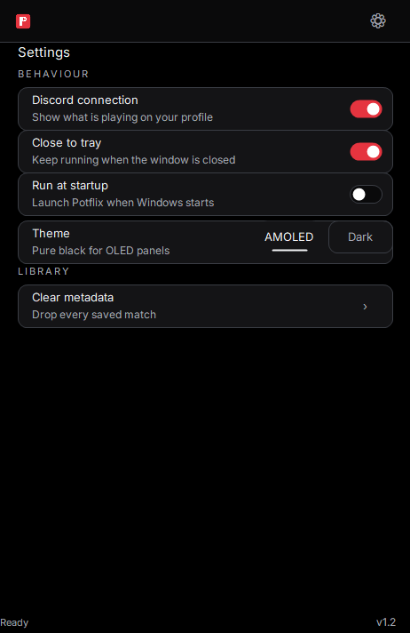

<p align="center">
  
</p>
<h1 align="center">Potflix</h1>
<p align="center"><strong>Show PotPlayer media in Discord Rich Presence - Rust.</strong></p>

<p align="center">
  <a href="LICENSE"></a>
  
  
</p>

## Install

Needs Windows, PotPlayer, the Discord desktop app, and a Rust toolchain with `cargo`. Build from source:

```powershell
git clone https://github.com/nathwn12/potflix.git
cd potflix
powershell -ExecutionPolicy Bypass -File tools\rust-build.ps1
.\dist\potflix.exe
```

## Usage

Run the exe and play media in PotPlayer:

```powershell
.\dist\potflix.exe
```

Discord shows `Watching <title>` while media plays. Closing the window parks the app in the tray; right-click the tray icon to open or exit.

## Configuration

| Key | Default | Effect |
| --- | --- | --- |
| `POTFLIX_CLIENT_ID`, `client-id.txt`, or `config.properties` | built-in ID | Discord app name and artwork; files are checked beside the exe, then in the current directory |

## Screenshots

<p>
  
  
</p>

## Development

```powershell
powershell -ExecutionPolicy Bypass -File tools\check.ps1 -Build -Selftest
```

Runs clippy, the workspace tests, the title-parity step, the build, and the headless selftest.

## Status

**Unverified** - as-is, use at your own risk.

## Links

- [Releases](https://github.com/nathwn12/potflix/releases)
- [Upstream project](https://github.com/ayunami2000/PotPlayer-DiscordRPC)
- [MIT](LICENSE)

<!-- nathwn12 house footer: identical in every repo. Do not edit. -->
<p align="center">
  <a href="https://github.com/nathwn12"></a>
</p>
<p align="center">
  <sub>Built by <a href="https://github.com/nathwn12">nathwn12</a> · <a href="https://github.com/nathwn12?tab=repositories">All projects</a></sub>
</p>
